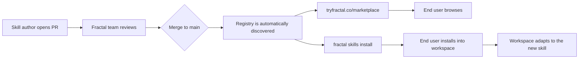

# AGENTS.md — `github.com/tryfractal/registry`

> **Last Updated:** 2026-06-26
> **Version:** 0.0.0
>
> **Audience:** Code Agents (human or AI) interacting with this repository — including:
>
> - **Maintainers** of the registry itself (the Fractal team).
> - **Skill authors** publishing or updating a skill in this registry.
> - **Consumers** who install a skill and want to understand what it ships.
>
> **Goal:** After reading this file end-to-end, an agent has full operational understanding of the registry — how skills are structured, how to author or update one, how the marketplace discovers them, and how to debug when something is off.

---

## 0. Repository Vision & Context

### What this repo is

The **Fractal Registry** is the public catalog of skills that extend the [Fractal Organic Operating System](https://tryfractal.co). A skill is more than a prompt — it can ship a `SKILL.md` (the agent-facing manual), instructions, agents, toolsets, collections, views, hooks, templates, artifacts, goals, and routines. Installing a skill makes the system adapt to the user's domain (see the [Fractal product manifesto](https://tryfractal.co/blog/organic-computing) — "skills can become applications").

The registry follows **the Fractal plugin descriptor** format (a thin opinionated layer over the Fractal runtime) so that every skill is interoperable with the rest of the runtime. The public [marketplace at `tryfractal.co/marketplace`](https://tryfractal.co/marketplace) discovers skills automatically — **this repo is the single source of truth**. There is no separate database, no admin UI, no CMS.

### Who this repo is for

Fractal is a **general computing model for human work** — not just for developers. The skill registry should therefore welcome contributors of every kind:

- a **developer** with a SaaS project,
- a **marketing agency** running campaigns and assets,
- a **content creator** managing channels and scripts,
- a **freelancer** tracking clients and deliverables,
- a **lawyer** managing cases and deadlines,
- a **professor** organizing classes and grading,
- a **small business owner** with a virtual store,
- or anyone whose day-to-day benefits from continuity, assistance, execution, and adaptive software.

A skill in this registry is a chance to **replace, in a personalized way, any other application** that the user or their team uses. Skills are not prompt packs — they are installable system capabilities that reshape the workspace.

---

## I. MAINTAINER GUIDE (Internal Architecture)

This section is for the **Fractal team** — anyone with merge rights on this repository. It covers the file layout, the operational flow, and the maintenance checklist.

### 1. FileSystem Topology

```
registry/                                  ← this repository
├── README.md                              ← public-facing hero + quick start
├── AGENTS.md                              ← this file (operational manual)
├── CHANGELOG.md                           ← registry-level changes only
├── LICENSE                                ← MIT
│
├── .github/                               ← community health
│   ├── CONTRIBUTING.md                      (authoring + PR guide)
│   ├── CODE_OF_CONDUCT.md                   (Contributor Covenant v2.1)
│   ├── SECURITY.md                          (vulnerability disclosure)
│   ├── PULL_REQUEST_TEMPLATE.md             (PR checklist)
│   ├── CODEOWNERS                           (review routing)
│   └── ISSUE_TEMPLATE/                      (7 issue templates + chooser)
│
└── skills/                                ← every skill is one folder
    ├── fractal/
    │   ├── SKILL.md                          (mandatory: agent manual)
    │   ├── .fractal/
    │   │   └── manifest.json                 (mandatory: marketplace descriptor)
    │   └── references/
    │       ├── discovery/                    (how Fractal capabilities work)
    │       └── guides/                       (how to do common things)
    │
    └── playwright/        (Playwright MCP — browser automation)
    └── chrome/             (mcp-chrome — real Chrome tabs/history/network)
    └── context7/           (Context7 MCP — library docs lookup)
```

Every MCP-only skill follows the same shape:

```
<skill>/
├── SKILL.md
├── .fractal/manifest.json
└── toolsets/
    └── mcp/                  (FractalToolset.create("mcp"))
```

#### Mandatory per-skill layout

| Path | Required | Purpose |
|---|---|---|
| `SKILL.md` | yes | Agent-facing manual. YAML frontmatter (`name` + `description` + `metadata.rules`) + Markdown body. Keep the description concise, imperative, and ideally under 1024 characters. |
| `.fractal/manifest.json` | yes | The Fractal plugin descriptor (see Section 15). |

#### Optional per-skill subfolders

A skill can ship any combination of the following. There is no required minimum — a skill may include just a `SKILL.md` and a `manifest.json`, or it may include all of them. **Most useful skills are app-shaped** and ship several of these together.

| Folder | Purpose |
|---|---|
| `references/` | Long-form documentation loaded on demand by the agent. |
| `toolsets/<name>/` | Toolset definitions. For single-toolset skills, use the canonical folder name that matches the transport type: `toolsets/mcp/` for MCP servers, `toolsets/api/` for OpenAPI integrations, `toolsets/cli/` for CLI wrappers. Custom toolsets may use one folder per entity. |
| `templates/` | LiquidJS templates the agent can render (code, emails, chat messages, contracts, etc.). |
| `instructions/` | Workspace-scoped behavioral rules injected on install. |
| `collections/` | Custom Fractal data collections. A skill can ship one or many collections (a CRM skill might ship `contacts`, `activities`, `deals`, etc.). |
| `views/` | Fractal view trees (`FractalView`) — these **adapt the internal UI of Fractal** for the workspace user. They can read from collections and use the full `fractal` context (workspaces, agents, tools, env, config, services). |
| `agents/` | Pre-configured sub-agents the orchestrator can recruit. |
| `hooks/` | `FractalHook` interceptors (PreToolUse, PostToolUse, etc.). |
| `artifacts/` | **Self-contained apps** (SPAs, static sites, dashboards) that run on the Fractal server, side-by-side with the agent. Distinct from views: artifacts are not embedded in the workspace UI; they are reachable via their own URL and can even be served under a custom domain. See Section 11 (Case C). |
| `goals/` | Predefined goals the user can adopt with one click. |
| `routines/` | Scheduled or webhook-triggered automations. |
| `assets/` | Logos, icons, screenshots referenced by the manifest. |

> **Important rule:** Skills MUST NOT include a `package.json`. The Fractal plugin SDK is installed at the workspace level (as a dependency of the project), not inside the skill. See Section 13 for details.

#### File patterns

Every subfolder has a conventional file name. Fractal discovers these files on disk, so getting the name wrong will silently make the capability unavailable. Stick to the patterns below:

| Folder | Expected file name | Example |
|---|---|---|
| `collections/` | `<name>.collection.ts` | `collections/contacts.collection.ts` |
| `views/` | `<name>.view.ts` | `views/contacts-dashboard.view.ts` |
| `toolsets/<name>/` | `index.ts` (the toolset entrypoint) | `toolsets/hubspot/index.ts` |
| `hooks/` | `<name>.hook.ts` | `hooks/audit-log.hook.ts` |
| `agents/` | `<id>/agent.md` | `agents/sdr/agent.md` |
| `artifacts/` | `<id>/source/index.html` (the artifact entrypoint) | `artifacts/crm-landing/source/index.html` |
| `goals/` | `<GOAL-XXX>/GOAL.md` | `goals/GOAL-001/GOAL.md` |
| `templates/` | `<name>.template.md` (or `.template.liquid`, `.template.ts`, …) | `templates/outreach.template.md` |
| `instructions/` | `(<group>/)?<name>.instruction.md` | `instructions/patterns/helper.instruction.md` |
| `references/` | any `*.md` | `references/discovery/agents.md` |
| `routines/` | `<name>.routine.ts` or `<name>/index.ts` | `routines/weekly-digest.routine.ts` |
| `assets/` | any binary file, referenced by the manifest | `assets/logo.svg` |

Notes:

- `<id>` (for `agents/` and `artifacts/`) is a semantic slug, lowercase-with-hyphens, unique within the skill.
- `<GOAL-XXX>` is the conventional Fractal goal id (auto-generated sequentially). When shipping predefined goals, let the user adopt them rather than hardcoding ids.
- Skills are independent. Do not reference another skill from `SKILL.md`; each skill must stand on its own.
- Write `SKILL.md` descriptions in imperative form (`Use this skill when…`), focused on user intent, with concrete trigger contexts and clear boundaries. Keep them under 1024 characters when possible.
- When defining a single toolset for an MCP / OpenAPI / CLI skill, keep the folder name canonical (`mcp`, `api`, or `cli`). Custom toolsets may be split by entity.
- Prefer a hosted image URL for `interface.logo` only when it is the best option; SVGL is preferred when available, but any absolute image URL is acceptable if it is valid and public.
- The `.fractal/` folder inside a skill is **exclusively for `manifest.json`** — do not put any other file in there.

### 2. Architecture Deep-Dive

The registry is a **GitHub-backed read-only catalog**. Every consumer reads from `github.com/tryfractal/registry` automatically — there is no database, no admin panel, no staging environment.



- **Author** opens a PR with a new `skills/<name>/` folder containing `SKILL.md` + `.fractal/manifest.json` (plus any optional subfolders).
- **Fractal team** reviews against the manifest schema and the [Fractal product vision](https://tryfractal.co/blog/organic-computing).
- **Merge** to `main` makes the skill live. The marketplace and the `fractal` CLI pick it up automatically.
- **End users** either browse the marketplace or run `fractal skills install <name>` to pull a skill into their workspace.

### 3. Operational Flow: Adding a Skill (Pipeline)

This is the end-to-end pipeline for a new skill landing in the marketplace.

1. **Triage (issue).** Author opens an issue using the **New skill submission** template (or a maintainer labels an existing **Skill request** issue as `type: new-skill`).
2. **Author locally.** Author forks the repo, creates a branch, adds `skills/<name>/` with the mandatory files (and any optional subfolders relevant to the skill's purpose).
3. **Open PR.** PR targets `main`. The PR template's checklist is auto-applied. A maintainer verifies the manifest against the schema in Section 15.
4. **Review.** A `CODEOWNERS`-routed review (currently the Fractal team) checks:
   - Manifest conforms to the schema in Section 15.
   - `name` matches the folder name.
   - `homepage` follows the `tryfractal.co/marketplace/<name>` convention.
   - `interface.category` is one of the 12 allowed values.
   - `interface.logo` (if set) is an absolute image URL that resolves successfully (SVGL preferred when available, but a public PNG/SVG/JPG URL is fine).
   - `version` follows semver and changes whenever the skill's behavior, toolset, or marketplace metadata changes materially.
   - No secrets, credentials, or PII in any file.
   - Skill does not duplicate an existing skill.
   - Skill is shaped like a coherent app (clear purpose, useful collections/views/toolsets for the target workspace).
5. **Approval and merge.** Once approved, a maintainer squashes and merges.
6. **Discovery.** Within minutes, the marketplace and the `fractal` CLI discover the new skill.
7. **Post-merge review.** A maintainer confirms the marketplace card renders, the detail page loads, and the install command works for at least one workspace.

### 4. Operational Flow: Updating a Skill

For a non-breaking patch or minor bump:

1. Author opens a PR. PR template's "Skill update" section is filled.
2. `version` field is bumped per semver.
3. `skills/<name>/CHANGELOG.md` (if present) gets a new entry.
4. If the change affects tool access, behavior, or marketplace metadata, confirm the `SKILL.md` description still fits the skill and remains under the 1024-character guidance.
5. Reviewer confirms the diff is additive or a fix.
5. Merge. The marketplace and CLI pick up the new version automatically.

For a **breaking change**:

1. Open a **Skill improvement** issue first. Discuss the migration plan.
2. Bump major version. Document the breaking change in `CHANGELOG.md` and (optionally) in the `SKILL.md` introduction.
3. Add a migration section to the skill's `README.md` or `references/migration.md`.
4. Reviewer verifies that the manifest diff is honest about the break.

### 5. Operational Flow: Working with the `gh` CLI

The `gh` CLI (https://cli.github.com) is the recommended way to drive the contribution flow from inside a chat with the user. Two paths are supported:

#### Path A — `gh` is installed and the user is authenticated

The agent can drive the entire contribution flow autonomously, with the user approving each step:

1. **Discover the right issue template** from `.github/ISSUE_TEMPLATE/`. Pick the one that matches the user's intent (skill request, bug, improvement, new skill, update, security, docs).
2. **Open the issue** with `gh issue create --template <name>.yml`, filling the template with the structured information the user has already shared.
3. **Create a branch** with `gh repo set-default` + `git checkout -b skills/<name>`.
4. **Author the skill locally** following the layout in Section 1.
5. **Validate the manifest** against the schema in Section 15 (manually today; a Bun validator is planned).
6. **Commit and push** with a clear message.
7. **Open the PR** with `gh pr create --fill`, which auto-applies the PR template's checklist.
8. **Respond to review comments** with `gh pr comment` / `gh pr review`.
9. **Watch CI** with `gh pr checks` and `gh run watch`.
10. **Merge** with `gh pr merge --squash` (or hand off to a maintainer).

The user remains in the loop at every step (confirmation before each external action). The agent never pushes to a branch the user hasn't approved, and never merges a PR on its own.

#### Path B — `gh` is not installed (or the user is not authenticated)

1. **Suggest installing `gh`**: `brew install gh` (macOS), `apt install gh` (Linux), `winget install --id GitHub.cli` (Windows).
2. **Guide the user through `gh auth login`** — pick GitHub.com, HTTPS, login with a web browser.
3. **Verify** with `gh auth status`.
4. Once `gh` is ready, switch to Path A.

If the user cannot or does not want to install `gh`, fall back to **manual contribution**: the agent produces the files, the user copies them into a fork, opens the PR through the GitHub web UI. The same issue templates and PR checklist apply.

### 6. State & Consistency

- **Source of truth**: `main` branch of this GitHub repository.
- **Discovery layer**: the marketplace and the `fractal` CLI both watch this repository. Once a skill is merged, it is automatically available.
- **Manifest as contract**: the manifest is parsed by the marketplace, the CLI install command, and the agent runtime. A field that is added to the manifest must also be supported by the consumer or it will be ignored.
- **Manifest validation**: an invalid manifest (missing required fields) is silently dropped from listings. To debug, look for `[marketplace] failed to parse manifest for <name>` in the marketplace logs.

### 7. Dependency & Type Graph

This repository has no build step, no TypeScript compilation, and no `node_modules`. Everything is consumed at runtime by external tools.

| Consumer | Reads | How |
|---|---|---|
| `tryfractal.co/marketplace` | `skills/*/.fractal/manifest.json` | Server-side discovery of this public repo |
| `fractal skills install <name>` | `skills/<name>/SKILL.md` and full folder | Cloned/downloaded into the workspace |
| `fractal skills get <name>` | same as above | Same |

There is no canonical "types" file in this repository — the manifest schema is documented in Section 15 below and is the single source of truth.

### 8. Maintenance Checklist

When adding a new skill, ensure:

- [ ] `skills/<name>/SKILL.md` exists with valid YAML frontmatter (`name`, `description`, `metadata.rules`).
- [ ] `skills/<name>/.fractal/manifest.json` exists and passes the schema in Section 15.
- [ ] `name` matches the folder name exactly.
- [ ] `path` is `/skills/<name>`.
- [ ] `homepage` is `https://tryfractal.co/marketplace/<name>`.
- [ ] `repository` is `https://github.com/tryfractal/registry`.
- [ ] `interface.category` is one of the 12 allowed values.
- [ ] `SKILL.md` description is imperative, user-intent focused, and ideally under 1024 characters.
- [ ] `toolsets/` follow the canonical single-toolset folder (`mcp`, `api`, or `cli`) when applicable.
- [ ] `interface.logo` (if set) is an absolute image URL that resolves successfully.
- [ ] No `package.json` in the skill folder. (See Section 13.)
- [ ] No secrets, credentials, or PII in any file.
- [ ] Optional: a `CHANGELOG.md` is added for the skill.

When reviewing a PR:

- [ ] All of the above.
- [ ] PR template's checklist is filled.
- [ ] Reviewer has confirmed that every collection, view, template, and artifact id the skill intends to register either does not collide with workspace-global ids or is _explicitly_ marked (in the PR body and in the `SKILL.md`) as an intended overwrite.
- [ ] The skill does not duplicate an existing one.
- [ ] The skill is shaped like a coherent app for its target workspace.
- [ ] The author is in `CODEOWNERS` (default: Fractal team).

When removing a skill:

- [ ] Open an issue with the **Skill update** template and mark it `status: removing`.
- [ ] Document the reason in the issue and in `CHANGELOG.md`.
- [ ] Bump the removed skill's version to a sentinel (`9.9.9-deprecated`) in a final commit, then delete the folder.
- [ ] The marketplace hides the skill automatically (folder gone from the listing).

### 8.1 Name collisions: skill-level vs workspace-global

When a skill ships collections, views, templates, artifacts, agents, or hooks, those resources can live in two scopes:

- **Skill-scoped**: `<workspace>/.fractal/skills/<skill-name>/views/dashboard.view.ts`. Only the skill can modify it. The skill can uninstall cleanly.
- **Workspace-global**: `<workspace>/.fractal/views/dashboard.view.ts`. Lives at the root of the workspace. Survives even after the skill is uninstalled.

Fractal discovers resources in both paths. If two resources share the same `id` or `name`, **the last one to be loaded wins** — and the load order is documented in the runtime, not in the skill. In practice, that means:

1. **Default to skill-scoped**: ship every collection / view / template / artifact / agent / hook inside the skill's own folder. This way the user can install, uninstall, or pin your skill without side-effects on other resources.
2. **Do not pollute the workspace-global scope from a skill**: if you _must_ register a workspace-global resource (for example, a shared view that needs to work even after the skill is updated), make that the exception, not the rule, and document it loudly in `SKILL.md`.
3. **Don't collide in the id namespace**: even if the runtime allows it, a `crm` skill that ships a global `views/dashboard.view.ts` will overwrite the user's hand-crafted `dashboard` view if they have one. Name your resources defensively: prefix them with the skill id (`crm-dashboard`, `crm-contacts`).
4. **Fractal auto-reloads on disk change**: modifying a file in either scope is picked up immediately — no gateway restart required. Keep that in mind when authoring: the user's workspace will change shape right in front of them as they experiment with your skill.

---

## II. CONSUMER GUIDE (Skill Author)

This section is for **anyone writing a new skill** or **updating an existing one**. Read it end-to-end before opening a PR.

### 9. Mindset: Skills Are Apps

Every skill you publish here is a chance to **replace, in a personalized way, any other application** that the user or their team uses in their day-to-day. A skill is not a prompt. A skill is not a chatbot persona. A skill is an **installable capability** that reshapes the user's workspace.

This means:

- **Start from the user's life, not from the technology.** A marketing agency does not need "a tool that connects to Mailchimp". They need a workspace that runs their campaigns end-to-end. Build the workspace.
- **Prefer app-shaped skills.** A single `crm-contacts` collection is a starting point, not a destination. The mature version of that skill is `crm` with `contacts`, `activities`, `deals`, plus a `contacts-dashboard` view, plus a `follow-up-reminder` routine, plus an `outreach` agent, plus a `crm-landing` artifact.
- **Skills adapt to the workspace, not the other way around.** The skill should look like a natural extension of what the user already does — the same vocabulary, the same mental model, the same rituals.
- **Respect the user's expertise.** A lawyer and a developer both use Fractal, but the surfaces they care about are different. Skills should expose what each persona needs, not a one-size-fits-all dashboard.
- **Use templates for repeatable work.** Not just code — email templates, message templates, contract templates, briefing templates. Anything the user repeatedly writes can become a template.
- **Use routines for autonomy.** A routine is a scheduled or webhook-triggered automation. Routines let the user's workspace act on its own, with the right guardrails.
- **Connect to anything.** A skill can wrap any external API, any MCP server, any CLI installed on the user's machine. The user already pays for these tools — meet them where they are.

### 10. Quick Start: Authoring Your First Skill

The shortest path from zero to a published skill.

#### Step 1 — Pick a name

- Lowercase letters, numbers, hyphens. No underscores, no dots, no spaces.
- Must be unique. Search the repo or browse the marketplace.
- Don't impersonate existing products. `<name>-for-fractal` is fine; `linear` is not.

#### Step 2 — Create the folder and `SKILL.md`

```bash
mkdir -p skills/my-skill/.fractal
```

`SKILL.md` content:

```markdown
---
name: my-skill
description: >
  What the skill does, when to trigger it, and what it can do.
  This description is the agent's first impression — write it carefully.
metadata:
  rules:
    - type: always
      instruction: "A behavioral rule that fires on every invocation."
---

# My Skill

Welcome message for the agent. Explain the skill's purpose, capabilities, and any constraints.
```

#### Step 3 — Create `.fractal/manifest.json`

```json
{
  "name": "my-skill",
  "version": "0.1.0",
  "description": "One paragraph describing the skill for the marketplace card.",
  "author": {
    "name": "Your Name",
    "email": "you@example.com",
    "url": "https://your-site.com"
  },
  "homepage": "https://tryfractal.co/marketplace/my-skill",
  "repository": "https://github.com/tryfractal/registry",
  "path": "/skills/my-skill",
  "license": "MIT",
  "keywords": ["example", "tag1", "tag2"],
  "interface": {
    "displayName": "My Skill",
    "shortDescription": "One line for the card.",
    "longDescription": "Non-technical, benefit-focused copy. Maximum 500 characters. Explains what the user gains — simple language, no jargon.",
    "developerName": "Your Name",
    "category": "Productivity",
    "capabilities": ["Read", "Write"],
    "websiteURL": "https://your-site.com",
    "privacyPolicyURL": "https://your-site.com/privacy",
    "termsOfServiceURL": "https://your-site.com/terms",
    "defaultPrompt": [
      "Help me get started with this skill.",
      "Give me a quick overview of what I can do here.",
      "Find something that might need my attention."
    ],
    "brandColor": "#10A37F",
    "logo": "https://your-site.com/logo.png"
  }
}
```

#### Step 4 — Add what makes the skill useful

Pick from the optional subfolders in Section 1. The most common combinations are:

- **Toolset + Collection** — wrap an external service and persist data locally (e.g. `crm` wrapping HubSpot with a `contacts` collection).
- **Collection + View** — shape a domain with persistent data and a dedicated dashboard (e.g. `restaurant` with a `reservations` collection and a `today` view).
- **Collection + View + Artifact** — a full app with a side-by-side dashboard (e.g. `crm` with contacts/activities/deals collections, a contacts-dashboard view, and a `crm-landing` artifact that the team can share with clients).
- **Toolset + Templates + Routines** — automate a recurring workflow (e.g. `podcast-os` with a YouTube uploader toolset, episode-description templates, and a weekly publish routine).
- **Agents + Hooks** — give the orchestrator a specialized worker and intercept key pipeline events.

#### Step 5 — Test in a real workspace

Fractal automatically reloads skills, toolsets, collections, views, artifacts, goals, routines, and agents whenever the files change on disk. You do not need to restart the gateway or copy any folder anywhere — just author your skill directly inside a real Fractal workspace and the system will pick up the changes.

The recommended workflow is to **author the skill from the start inside a real workspace** of the same kind the skill targets. If you're building a `restaurant` skill, work inside a workspace you set up for a restaurant. This way you exercise every surface in its natural context:

1. Open the workspace UI and confirm the skill appears in the skills list.
2. Confirm the `SKILL.md` loads without errors.
3. If the skill ships **collections**, create / read / update / delete a record of each.
4. If the skill ships a **view**, open it and confirm it renders with its data bound.
5. If the skill ships a **toolset**, invoke a tool through the orchestrator and check the result.
6. If the skill ships an **artifact**, open its URL (and its custom domain, if configured).
7. If the skill ships **agents**, talk to the orchestrator about each of them and confirm the specialist answers.
8. If the skill ships **routines**, trigger one manually before scheduling it.
9. If the skill ships **templates**, render one.
10. If the skill ships **hooks**, trigger the tapped pipeline event and confirm interception.
11. Look at the logs under `~/.fractal/logs/` for parse errors if anything is missing.

**Critical constraint:** Your skill must not depend on any particularities of the workspace you happened to test in. A skill in this registry can be installed by any user on any workspace, so the skill must work on a fresh workspace of a compatible domain — never rely on a global state, a folder layout, or an environment variable that only exists on your machine.

#### Step 6 — Open a PR

Use the **New skill submission** issue template. Fill the PR template's checklist. Wait for review.

### 10.1 How skills are discovered & installed

Once your skill is merged to `main`, it becomes available to anyone in three equivalent ways:

#### Inside a Fractal workspace (agent tools)

Agents running inside Fractal have native access to the marketplace through tools — you do not need to remember any command:

- **Discovery tool**: searches the Fractal marketplace (and, optionally, other public skill registries) by free-text query. Pass `owner: "tryfractal"` to scope to this registry. Read its inline documentation once inside Fractal for the full contract.
- **Get tool**: fetches a single skill by passing either a local id (`playwright`) or a compact remote source (`tryfractal/registry@playwright`) _without_ installing it — used to review a skill before committing, or to grab a skill's instructions only for the current conversation.
- **Install tool**: downloads `SKILL.md` (and every bundled subfolder) from GitHub into `<workspace>/.fractal/skills/<name>/`, stamps `metadata.version` and `metadata.source` onto the frontmatter, and makes the skill active across sessions. Fractal auto-reloads after the install — no restart required.

#### From the human CLI (`fractal skills ...`)

The Fractal CLI (`@fractal-os/cli`, the same command used to manage the gateway) exposes `skills discovery`, `skills get`, `skills install`, with the exact same contracts as the agent tools above. Use them from a terminal when Fractal is not running, or when scripting installs:

```bash
fractal skills discovery --query "playwright" --owner tryfractal
fractal skills get tryfractal/registry@playwright
fractal skills install --source tryfractal/registry --skill playwright
```

#### From external ecosystems (Claude Code, Cursor, Codex, Windsurf, etc.)

The `SKILL.md` frontmatter is the same standard contract used elsewhere in the wider skill ecosystem; those consumers can also run:

```bash
npx @fractal-os/cli@latest skills install ... --source tryfractal/registry
```

…to pick up skills from this registry without committing to a full Fractal install. Those external ecosystems only consume the `SKILL.md` + optional `references/`; they ignore the Fractal-specific subfolders (`toolsets/`, `views/`, `collections/`, `artifacts/`, `goals/`, `routines/`, `agents/`, `hooks/`, `templates/`). This is fine — the skill ships one agent-facing manual, and richer capabilities simply don't light up outside Fractal.

What this means for authoring:

- Your `SKILL.md` must be self-describing enough that a non-Fractal agent still gets value from it.
- Don't hardcode Fractal-only behaviors in `SKILL.md`. If the skill needs a toolset to work, say so explicitly — non-Fractal agents will skip that, but won't break.

### 11. Real-World Use Case Library

#### Case A — Skill that ships collections and a view (a domain's data layer)

The skill brings its own data model and a dedicated view. Example: a `restaurant` skill that ships a `reservations` collection and a `today` view. The view reads from the collection and shows the day's bookings.

Useful when: the user's day-to-day is dominated by reading and writing a specific kind of record.

#### Case B — Skill that wraps external systems with a toolset

The skill connects to an external service. A toolset can be backed by any of:

- an **MCP server** (stdio or HTTP) — the toolset adapter speaks MCP,
- an **OpenAPI specification** — the toolset adapter introspects the spec and exposes each endpoint as a tool,
- a **CLI installed on the user's machine** — the toolset adapter shells out to the binary,
- **custom tools with manual logic** — the toolset is defined in the skill with `FractalTool` builders and the handler implements the integration directly.

Example: a `crm` skill wrapping HubSpot. A `podcast-os` skill wrapping YouTube and RSS. A `real-estate` skill wrapping MLS APIs. The agent can also call these toolsets through the marketplace, and the agent's flow becomes the user's flow.

Useful when: the user's day-to-day involves a tool they already pay for. The skill doesn't replace the tool — it puts the tool inside the user's workspace, alongside their data and their routines.

#### Case C — Skill that ships a self-contained artifact (a side-by-side app)

The skill ships an artifact: a self-contained web app (SPA, static site, dashboard) that runs on the user's Fractal server, reachable via its own URL. Distinct from a view (which lives inside the Fractal workspace UI), an artifact is a standalone surface that the user can share with other people, optionally under a custom domain.

Artifacts can be:

- A landing page the user shares with leads.
- A client portal that reads from the workspace's collections.
- A dashboard that pulls data from collections and renders it with a custom UI library.
- A mini-tool the user shares with a specific audience (e.g. a quote calculator for prospects).

Because artifacts run on the same server as the agent, they can call the **Fractal OpenAPI spec** directly — the spec is published at `/api/docs/openapi.json` on the user's Fractal server (whatever URL or port the workspace is running on). A React SPA in an artifact can:

- read records from any collection (e.g. `contacts.findMany(...)`),
- create or update records through the appropriate endpoints,
- trigger a toolset's tool by calling the corresponding endpoint, and use the result in the UI.

This is useful when: a view is not enough (you need a custom UI library, a public URL, or a different audience), or when the data flow is complex enough that calling the API directly from the frontend is simpler than re-implementing the logic in TypeScript.

Useful when: the user needs a dedicated surface outside of Fractal UI (clients, leads, teammates) that lives outside the workspace UI.

#### Case D — Skill that ships a view that adapts the workspace UI

The skill ships a view. A view lives **inside** the Fractal workspace — it is rendered in the workspace shell, on a dedicated page, and is visible only to the user (or to people with workspace access). The view is not a standalone URL; it is part of the workspace.

A view is the right surface when:

- you want to reshape the workspace itself for a new domain,
- the user already lives in the workspace and wants a more powerful surface than the chat,
- the view should respect the workspace's theme, navigation, and mental model.

A view's data handler receives a `fractal` parameter that exposes **the full Fractal API** for the current workspace. From inside the view, the agent can:

- read or write any collection,
- invoke any toolset's tool,
- call external services (APIs, MCP servers, CLIs) directly,
- read or write templates, routines, goals, instructions, agents, tasks, memory,
- access the workspace's environment variables and config.

The view is the user's home for a domain. It is the place where the data, the actions, and the agent's assistance meet.

Useful when: the workspace itself should look different for a new domain.

#### Case E — Full app (collections + view + artifact + toolset + routines)

The most complete shape. The skill replaces a third-party application in the user's day-to-day. Example: a `crm` skill with:

- collections: `contacts`, `activities`, `deals`,
- a view: `dashboard` for the workspace,
- an artifact: `landing-page` for share with potential leads,
- a toolset: HubSpot or Pipedrive wrapper for external sync,
- routines: daily follow-up reminder, weekly pipeline digest,
- templates: outreach email, meeting notes, contract template,
- instructions: tone of voice, sales methodology,
- agents: a specialized SDR sub-agent.

This is the **"skill as app"** pattern. When a skill reaches this shape, it can fully replace a SaaS for the user's specific workflow.

### 11.1 Code skeletons for each subfolder

The snippets below are the **minimal, copy-paste-ready** starting point for each kind of subfolder a skill can ship. They are intentionally short — for the full API surface, always read the SDK's `README.md`, `AGENTS.md`, and `dist/index.d.ts` inside `node_modules/@fractal-os/plugin/` before authoring (see Section 13).

All TypeScript snippets below assume the SDK is installed at the workspace level:

```ts
import {
  FractalCollection,
  FractalView,
  FractalTool,
  FractalToolset,
  FractalHook,
  FractalError,
} from "@fractal-os/plugin";
```

#### Collection — `collections/<name>.collection.ts`

A typed, queryable table inside the workspace. Records are validated against the schema on every write; lifecycle hooks (`onCreated`, `onUpdated`, `onDeleted`, `onList`, `onRead`) let you react to data changes. The hook callback receives `{ value, previousValue, fractal, workspace }` — `fractal` exposes the env, config, and the resolved workspace runtime.

```ts
import { z } from "zod";
import { FractalCollection } from "@fractal-os/plugin";
import { randomUUID } from "crypto";

export default FractalCollection.create("contacts")
  .withIdGenerator(randomUUID)
  .withPatterns([".fractal/skills/crm/data/contacts/{id}.contact.md"])
  .withSchema(z.object({
    name: z.string().min(1),
    email: z.string().email(),
    stage: z.enum(["lead", "qualified", "customer"]).default("lead"),
  }))
  .onCreated(async ({ value, fractal }) => {
    console.log(`New contact in workspace "${fractal.config.name}":`, value.email);
    return value;
  })
  .build();
```

#### View — `views/<name>.view.ts`

A node tree that adapts the Fractal UI to the skill's domain. `withData` runs server-side before render and returns `{ items, stats?, extra? }`; the handler receives `{ options, fractal }` where `fractal` exposes the full workspace context (env, config, workspace services). Use `valuePath` on tree nodes to bind data into the renderer.

```ts
import { FractalView } from "@fractal-os/plugin";

export default FractalView.create("contacts-dashboard")
  .withTitle("Contacts")
  .withDescription("Pipeline overview")
  .withMetadata({ icon: "Users", order: 1 })
  .withData(async ({ options, fractal }) => {
    const items = await fractal.workspace.core.collections
      .get("contacts")
      .findMany({ take: options?.take ?? 50 });

    return {
      items,
      stats: { total: items.length },
    };
  })
  .withTree([
    {
      component: "Section",
      props: { title: "Contacts" },
      children: [
        { component: "Metric", props: { title: "Total" }, valuePath: "/stats/total" },
        {
          component: "Table",
          props: {
            columns: [
              { key: "name", label: "Name" },
              { key: "email", label: "Email" },
              { key: "stage", label: "Stage" },
            ],
          },
          valuePath: "/items",
        },
      ],
    },
  ])
  .build();
```

#### Toolset — `toolsets/<name>/index.ts`

A grouped set of callable tools under a shared connection transport. The connection type is a discriminated union — pick the one that matches how the tools are executed:

| `connection.type` | What it does |
|---|---|
| `mcp-server::stdio` | Spawn a local MCP server as a subprocess (uses `command` + `args[]`) |
| `mcp-server::http` | Connect to a remote MCP server over HTTP/SSE (uses `url`) |
| `rest-api` | Wrap a REST API (uses `url` + optional `headers`) |
| `cli` | Wrap a command-line tool installed on the user's machine |
| `custom` | In-memory TypeScript handlers added via `.addTool()` |

MCP, REST, and CLI toolsets are introspected by the runtime at load time — you declare the connection and the tools are discovered automatically (this is what powers "generate a toolset from any OpenAPI spec or any CLI on the user's machine").

```ts
import { FractalToolset } from "@fractal-os/plugin";

// Option A: MCP stdio — tools are introspected from the server.
export const PlaywrightTools = FractalToolset.create("playwright")
  .withDescription("Browser automation via the Playwright MCP server")
  .withConnection({
    type: "mcp-server::stdio",
    command: "npx",
    args: ["-y", "@playwright/mcp@latest"],
  })
  .build();

// Option B: REST API — tools are generated from the OpenAPI spec.
export const StripeTools = FractalToolset.create("stripe")
  .withConnection({
    type: "rest-api",
    url: "https://api.stripe.com/v1",
    headers: { Authorization: `Bearer ${process.env.STRIPE_API_KEY}` },
  })
  .build();

// Option C: CLI wrapper — wraps a binary already on the user's PATH.
export const GitTools = FractalToolset.create("git")
  .withConnection({ type: "cli", command: "git" })
  .build();

// Option D: custom — bundle hand-written tools.
export const CrmTools = FractalToolset.create("crm-actions")
  .withConnection({ type: "custom" })
  // .addTool(addContactTool)   // see next snippet
  .build();
```

#### Tool — `tools/<name>/index.ts` (or inside a custom toolset)

A single callable action. Receives `{ input, fractal }`; the handler's return value is what the agent sees. Use this to give a custom toolset its own hand-written actions, or to expose one-off callable behaviors.

```ts
import { z } from "zod";
import { FractalTool } from "@fractal-os/plugin";

export const AddContact = FractalTool.create("add-contact")
  .withDescription("Add a new contact to the workspace CRM collection")
  .withSchema(z.object({
    name: z.string(),
    email: z.string().email(),
  }))
  .withHandler(async ({ input, fractal }) => {
    return fractal.workspace.core.collections
      .get("contacts")
      .create({ data: input });
  })
  .build();
```

#### Hook — `hooks/<name>.hook.ts`

Intercepts a pipeline event. Supported event types: `PreToolUse`, `PostToolUse`, `SessionStart`, `SessionEnd`, `PrePrompt`, `PostPrompt`. The handler receives the full event and can inspect `event.input`, modify it, or throw to block execution.

```ts
import { FractalHook } from "@fractal-os/plugin";

export const GuardDestructiveCommands = FractalHook.create("guard-destructive-commands")
  .onType("PreToolUse")
  .withHandler(async (event) => {
    const cmd = (event.input.toolInput?.command ?? "") as string;
    if (cmd.includes("rm -rf") || cmd.includes(":(){ :|:& };:")) {
      throw new Error("Destructive terminal commands are forbidden in this workspace.");
    }
    return event.output;
  })
  .build();
```

#### Custom error — `errors/<name>.errors.ts`

A typed error class with codes, messages, and CTAs. Throw these from your tool/view handlers; agents and CLI consumers see a structured `{ code, message, cta }` payload.

```ts
import { z } from "zod";
import { FractalError } from "@fractal-os/plugin";

const NotFoundIssue = z.object({ id: z.string() });

export const ContactErrors = FractalError.create()
  .addError("CONTACT_NOT_FOUND", {
    status: 404,
    schema: NotFoundIssue,
    message: ({ issue }) => `Contact ${issue?.id} could not be found.`,
    cta: ({ issue }) => ({
      description: "Check the contact id or list all contacts.",
      commands: [
        { command: `fractal collections list contacts`, description: "List all contacts" },
      ],
    }),
  })
  .build();

// throw new ContactErrors({ code: "CONTACT_NOT_FOUND", issue: { id } });
```

#### Artifact — `artifacts/<id>/ARTIFACT.md` + `source/`

A standalone web app that runs on the user's Fractal server, side-by-side with the workspace. An artifact is **just a folder** — the runtime discovers it and serves its `entrypoint`. Two flavors work equally well:

**Option 1 — A static HTML page (one file, no build):**

```
artifacts/
└── crm-landing/
    ├── ARTIFACT.md              ← metadata + visibility + serve pattern
    └── source/
        ├── index.html
        └── public/              ← static assets (images, fonts, ...)
```

The `ARTIFACT.md` is a plain Markdown file with YAML frontmatter describing the artifact. The runtime reads `entrypoint`, `serve`, `visibility`, and `secret` (hashed password) from it:

```markdown
---
name: CRM Landing
entrypoint: .fractal/skills/crm/artifacts/crm-landing/source/index.html
serve: .fractal/skills/crm/artifacts/crm-landing/source/public/**/*
visibility: workspace
createdAt: 2026-06-23T15:36:27.143Z
updatedAt: 2026-06-23T15:53:00.000Z
---
```

Visibility options: `private` (only authenticated workspace users), `workspace` (open on the local network), `by_password` (prompts for a password — the `secret` field stores the bcrypt hash). A custom domain can be bound to the artifact so it serves at `https://crm.example.com` instead of the default `/v/<workspace>/artifacts/crm-landing/` path; that requires the user's Fractal gateway to be reachable (local tunnel or fixed public IP).

Because the artifact runs on the same origin as the user's Fractal server, it can call the full Fractal API directly using any HTTP client — the OpenAPI spec is published at `/api/docs/openapi.json` on the user's workspace URL. A small `fetch` wrapper is all you need.

**Option 2 — A Vite SPA (modern build, React/Vue/Svelte, etc.):**

For richer apps, build the SPA with Vite and ship the static `dist/` folder. Vite's default config already produces a folder of static files (no server-side runtime needed) — point `entrypoint` at `dist/index.html` and `serve` at `dist/**/*`:

```
artifacts/
└── crm-dashboard/
    ├── ARTIFACT.md
    └── source/
        ├── package.json         ← Vite app (built into ./dist)
        ├── vite.config.ts
        ├── index.html
        ├── src/                 ← React/Vue/Svelte source
        └── dist/                ← `bun run build` output — what the runtime actually serves
            ├── index.html       ← entrypoint
            └── assets/...
```

The `ARTIFACT.md` points at the **built** output, not the source:

```markdown
---
name: CRM Dashboard
entrypoint: .fractal/skills/crm/artifacts/crm-dashboard/source/dist/index.html
serve: .fractal/skills/crm/artifacts/crm-dashboard/source/dist/**/*
visibility: workspace
createdAt: 2026-06-23T15:36:27.143Z
updatedAt: 2026-06-23T15:53:00.000Z
---
```

The artifact is self-contained — it can read from Fractal collections, call Fractal tools through the OpenAPI, or render purely from its own bundle. For complex data flows, prefer calling dedicated toolsets instead of re-implementing logic in the SPA: a toolset's tool is callable both by an agent and from a SPA via the OpenAPI endpoint, so a single implementation serves both surfaces.

#### Instruction — `instructions/<group>/<name>.instruction.md`

A reusable behavioral rule for the agent. One file per rule; group them under `patterns/`, `standards/`, or `workflows/`. The frontmatter is what Fractal uses to inject the rule into the right context. Below is a real workflow for a CRM skill — the agent is told exactly when to ask the user before moving a contact between pipeline stages.

```markdown
---
name: CRM Pipeline Stage Transitions
type: workflows
description: How the agent should move a contact between pipeline stages (lead → qualified → customer) in the CRM skill.
paths:
  - '.fractal/skills/crm/**/*'
---

# CRM Pipeline Stage Transitions

## Main Context
The agent assists the user with the CRM. Moving a contact between pipeline stages is a state change with business consequences (it triggers the next-step automation, changes the dashboard metrics, and notifies the assigned owner). The agent must never move a stage silently — the user is always the source of truth.

## Mental Model
**Pipeline stages are checkpoints, not goals.** A contact advances one stage at a time, only when the user explicitly asks for it, and only when the conditions for the next stage have been met. The agent's job is to surface the signal, not to act on it.

## Rules
- **ALWAYS** show the current stage and the proposed next stage before any change, side by side.
- **ALWAYS** ask the user to confirm the move, with one short sentence explaining *why* this contact is ready (e.g. "They replied to the second email yesterday with a date for a call").
- **NEVER** skip a stage. `lead → customer` directly is forbidden even if the user asks — the system requires at least one intermediate stage for reporting and auditability.
- **NEVER** move a contact *backwards* (e.g. `qualified → lead`) without an explicit reason captured in the contact's activity log.
- **WHEN** the user says "go ahead" or "do it" without naming a contact, **ASK** which contact they mean — never guess.

## Critical Checkpoints
- [ ] The current stage and proposed next stage were both shown.
- [ ] The user explicitly confirmed the move (no inference from ambiguous phrases).
- [ ] No stage was skipped or reversed.
- [ ] The activity log entry explains *why* the move happened.
```

#### Template — `templates/<name>.template.md`

A LiquidJS template the agent can render — for emails, contracts, code scaffolds, message drafts, anything. The frontmatter declares where the rendered file lands and (optionally) the JSON Schema used to validate the inputs.

```markdown
---
name: Outreach Email
description: Cold outreach email for a new lead.
output: drafts/outreach/{{ contact.name | slugify }}.email.md
schema:
  type: object
  properties:
    contact: { type: object, properties: { name: { type: string }, company: { type: string } } }
    sender:  { type: object, properties: { name: { type: string }, role: { type: string } } }
  required: [contact, sender]
---

# Subject: Quick idea for {{ contact.company }}

Hi {{ contact.name }},

I noticed {{ contact.company }} is in the middle of ...
...
```

Templates aren't limited to code — a skill can ship a `whatsapp-followup.template.md`, a `meeting-notes.template.md`, a `client-quote.template.md`, etc. Anything an agent needs to draft repeatedly is a good fit.

#### Goal — `goals/GOAL-XXX/GOAL.md`

A predefined, high-level objective the user can adopt with one click. One folder per goal; the folder name (`GOAL-XXX`) is the unique id, and the file inside is always `GOAL.md`. The frontmatter carries the operational metadata; the body is the strategic narrative the agent and the user refer back to.

```markdown
---
slug: crm-fill-q3-pipeline
title: Fill the Q3 pipeline with 50 qualified leads
description: Reach 50 qualified leads in the CRM pipeline by the end of Q3.
priority: high
deadline: '2026-09-30T00:00:00.000Z'
status: active
createdAt: '2026-07-01T10:00:00.000Z'
updatedAt: '2026-07-01T10:00:00.000Z'
---

**Objective**

Reach 50 contacts in the `qualified` stage of the CRM pipeline by the end of Q3.

**What success looks like**

* 50 contacts in the `qualified` stage by the deadline.
* Each qualified contact has a logged discovery call or equivalent signal.
* The conversion rate from `lead` to `qualified` is at least 20%.

**Focus areas**

* Outbound: prioritize the 200-lead list from the marketing team.
* Inbound: respond to every form submission within 24 hours.
* Referrals: ask each customer (this quarter) for one warm intro.

**Exit criteria**

* [ ] 50 contacts are in the `qualified` stage.
* [ ] Each qualified contact has at least one activity log entry beyond the initial outreach.
* [ ] The weekly pipeline digest is being sent without manual intervention.

**Notes**

This goal replaces the previous "grow to 100 leads" goal — quality matters more than raw count for this quarter. Coordinate with the marketing team before changing the focus areas.
```

#### Routine — `routines/<name>/ROUTINE.md`

A scheduled or webhook-triggered automation. The routine is a **Markdown prompt** the owning agent receives when the trigger fires — the agent runs it like a normal task. Two trigger types are supported out of the box: `scheduled` (cron expression) and `webhook` (token-authenticated POST). Below is a real CRM example: a weekly pipeline digest sent every Monday morning.

```markdown
---
name: Weekly Pipeline Digest
agent: atlas
triggers:
  - type: scheduled
    config:
      cron: 0 9 * * 1
status: enabled
createdAt: '2026-07-01T10:00:00.000Z'
updatedAt: '2026-07-01T10:00:00.000Z'
---

# Weekly Pipeline Digest

## Mission

Every Monday at 09:00, give the user a one-page read of where the CRM pipeline stands so they can plan their week.

## Review Scope

* All contacts grouped by pipeline stage (`lead`, `qualified`, `customer`)
* Contacts that changed stage in the last 7 days
* Top 5 contacts by last activity date that have **no** next-step logged
* Goal progress against the active CRM goal(s) in `.fractal/goals/`

## Required Fractal Actions

* Read the `contacts` collection — no writes, this is a read-only digest
* Render the `weekly-pipeline-digest` template with the aggregated data
* Send the rendered output to the user as a chat message (not as a file)

## Operating Principles

* Lead with the numbers, then the names — the user wants the headline first
* Highlight *changes*, not the steady state
* If a contact has no next step, name them explicitly so the user can act
* Never suggest moving pipeline stages in the digest — that's the user's call

## Expected Outcome

The user opens Fractal on Monday morning and immediately knows: how many leads, how many qualified, who needs follow-up, and how the quarter is tracking against the active CRM goal.
```

A webhook-triggered routine looks similar but uses `triggers: [{ type: "webhook", config: { token: "<auto-generated>" } }]` and is fired by an external system POSTing to the routine's fire URL with the token. The webhook payload becomes the routine's `input`.
```

#### Reference — `references/<file>.md`

Long-form documentation the agent loads on demand when the skill is invoked. Use this for things the agent shouldn't keep in active context, but that it can pull when needed: API references, business rules, glossaries, link dumps.

### 12. Domain-Specific Guidance

#### Choosing a category

Pick the most specific fit. The 12 allowed values are: `Productivity`, `Development`, `Communication`, `Data`, `Design`, `DevOps`, `AI`, `Research`, `Finance`, `Marketing`, `Sales`, `Education`. If your skill doesn't fit any of these, open an issue and we'll discuss adding a new one.

#### Choosing capabilities

`Read` means it fetches data; `Write` means it creates or modifies; `Execute` means side-effecting operations (delete, deploy, send email); `Network` means it calls external APIs; `Persist` means it stores structured data in a collection.

#### Writing `defaultPrompt`

`defaultPrompt` is shown to the user as a "what can I do with this skill?" suggestion. Write 2-3 short imperatives, each starting with the skill name. They should be actionable and specific, not generic.

#### Picking a brand color

Use a color that is recognizable for the underlying service. The marketplace uses it as the accent for the card and the detail page. Hex format (`#RRGGBB`).

#### Logo URL

Must be an **absolute URL** that returns 200. PNG, SVG, or JPG. Square aspect ratio preferred.

### 13. The `@fractal-os/plugin` SDK — Required Reading

Most useful skills will use the **Fractal Plugin SDK** (`@fractal-os/plugin`) to define their toolsets, views, collections, hooks, and errors with a fluent, type-safe builder API. The SDK is a thin, opinionated wrapper that exposes only the Fractal-native API surface; you do not need to know any implementation detail of the Fractal runtime to use it.

#### Install the SDK at the workspace level — NOT inside the skill

**Skills MUST NOT include a `package.json`.** The SDK is a project dependency — it is installed in the user's workspace, not bundled with the skill. The skill folder contains only source files (`SKILL.md`, `manifest.json`, `*.ts`, etc.), never `package.json`, never `node_modules`, never a build output.

The skill's `import` statements assume the SDK is present:

```ts
import { FractalView, FractalTool, FractalToolset, FractalCollection, FractalHook, FractalError } from "@fractal-os/plugin";
```

When the skill is installed, the workspace already has (or will install) the SDK. If the user does not have it, the agent or the workspace setup must install it.

> **Note on `zod`:** The SDK declares `zod >=4.x` as a peer dependency. If the user's workspace does not yet depend on `zod`, install it alongside the SDK (for example `bun add zod` or `npm install zod`). Almost every builder in the SDK takes a Zod schema, so a missing `zod` will surface immediately as the first import fails.

#### Mandatory: read the SDK docs before authoring

Before you write a single `FractalView`, `FractalToolset`, or any other builder, you MUST:

1. Install the SDK in the project (typically `bun add @fractal-os/plugin` or `npm install @fractal-os/plugin`).
2. Locate the installed package in `node_modules/@fractal-os/plugin/`.
3. Read the SDK's `README.md` **and** `AGENTS.md` (when present) end-to-end.
4. Read the SDK's `dist/index.d.ts` if you need to introspect the full public API.

Do not guess the API surface. The SDK is the contract between your skill and the runtime. If you write a skill against an outdated mental model, the skill will not work.

#### What the SDK gives you

- **`FractalTool`** — define a callable action with a Zod input schema and an async handler. The handler receives `{ input, fractal }` where `fractal` exposes the full workspace context.
- **`FractalToolset`** — group tools under a connection configuration. A toolset's connection can be an MCP server, an OpenAPI spec, a CLI invocation, or a custom adapter.
- **`FractalCollection`** — define a persistent data collection with a Zod schema, lifecycle hooks, and queries.
- **`FractalView`** — define a UI tree that renders inside the workspace. The data handler receives `{ fractal }` with full access to the workspace API.
- **`FractalHook`** — intercept pipeline events (`PreToolUse`, `PostToolUse`, `SessionStart`, `SessionEnd`, `PrePrompt`, `PostPrompt`).
- **`FractalError`** — define diagnostic error codes with actionable CTAs.

The SDK is published on npm and is the same SDK used by Fractal internally. If you need to do something the SDK does not expose, you can always drop down to the underlying API, but prefer the SDK for clarity and type safety.

### 14. Best Practices & Anti-Patterns

| Practice | Why? | Example |
|---|---|---|
| ✅ Use lowercase, hyphens only | Consistency with the marketplace URL slug | `my-cool-skill` |
| ✅ Make `name` match the folder | The CLI uses the folder name as the install key | `skills/my-cool-skill/` → `name: "my-cool-skill"` |
| ✅ Bump `version` on every change | The CLI uses it to detect updates | `0.1.0` → `0.1.1` for a patch |
| ✅ Set `homepage` to the marketplace URL | Users land on the right detail page | `https://tryfractal.co/marketplace/my-cool-skill` |
| ✅ Write `shortDescription` as one line | It's shown on the card | `"Send messages via WhatsApp from your workspace."` |
| ✅ Document every tool in `SKILL.md` | The agent needs to know when to use them | See `skills/playwright/SKILL.md` |
| ✅ Build app-shaped skills | Skills should replace a third-party app, not be a prompt | `crm` with contacts/activities/deals + a view + an artifact |
| ✅ Write `longDescription` in simple, benefit-focused language | It's shown on the marketplace detail page to all users, not just devs | `"Imagine your agent being able to look up anything in your Airtable bases in real time…"` |
| ✅ Write `defaultPrompt` as user conversation starters (max 3) | These are example prompts the user sends to their agent, not instructions to the agent | `"Help me get started — show me what I have in Airtable."` |
| ✅ Read the `@fractal-os/plugin` docs before authoring | The SDK is the contract | Read `node_modules/@fractal-os/plugin/README.md` and `AGENTS.md` first |
| ❌ Don't use uppercase or spaces in the folder | CLI will not find the skill | `MyCoolSkill/` breaks install |
| ❌ Don't hardcode `https://tryfractal.co` in skills | Breaks local dev | Use env vars or config |
| ❌ Don't include credentials or tokens in any file | Even in examples | Use placeholders like `<YOUR_API_KEY>` |
| ❌ Don't skip the YAML frontmatter in `SKILL.md` | The agent cannot read the skill without it | `name`, `description`, `metadata.rules` are required |
| ❌ Don't bump major version without a migration plan | Breaks user workspaces | Open an improvement issue first |
| ❌ Don't ship a `package.json` inside the skill | Skills are source-only; the workspace owns deps | The SDK is installed at the workspace level, not in the skill |
| ❌ Don't ship an empty or placeholder `defaultPrompt` | The marketplace shows these as the user's first impression | Fill with 2-3 real, generic sentences the user could actually say |
| ❌ Don't use placeholders like `[Table Name]` or fake names in `defaultPrompt` | The prompt must make sense as-is to any user | Use generic phrases like "Give me an overview" or "Find something that needs attention" |
| ❌ Don't ship a "pure-prompt" skill with no value | It does not adapt the workspace | Add at least one collection, view, toolset, or template |

---

## III. TECHNICAL REFERENCE & RESILIENCE

This section is the exhaustive reference. It exists so that an agent can debug or extend the registry without external docs.

### 15. Exhaustive API Reference — Manifest Schema

| Field | Type | Required | Notes |
|---|---|---|---|
| `name` | string | yes | Unique skill id. Must match the folder name. Used as the marketplace URL slug and the CLI install key. |
| `version` | string | yes | Semver. Bump on every change. |
| `description` | string | yes | One-paragraph summary. Shown on the marketplace card. |
| `author.name` | string | yes | Display name. |
| `author.email` | string | no | Contact email. Not shown on the marketplace. |
| `author.url` | string | no | Author's website. Shown on the detail page. |
| `homepage` | string | yes | Convention: `https://tryfractal.co/marketplace/<name>`. |
| `repository` | string | yes | `https://github.com/tryfractal/registry`. |
| `path` | string | yes | `/skills/<name>`. |
| `license` | string | yes | SPDX identifier or `SEE LICENSE IN LICENSE`. |
| `keywords` | string[] | no | Search tags. Lowercase, hyphens. |
| `interface.displayName` | string | yes | Human-friendly name. |
| `interface.shortDescription` | string | yes | One-liner. Shown on the card. |
| `interface.longDescription` | string | no | Non-technical, benefit-focused copy shown on the detail page. Maximum 500 characters. Must explain what the user gains by installing the skill — simple language, no implementation details, no jargon. Should work for any type of user, not just developers. Can include basic Markdown. |
| `interface.developerName` | string | no | Display name of the developer/team. |
| `interface.category` | string | yes | One of: `Productivity`, `Development`, `Communication`, `Data`, `Design`, `DevOps`, `AI`, `Research`, `Finance`, `Marketing`, `Sales`, `Education`. |
| `interface.capabilities` | string[] | no | Subset of: `Read`, `Write`, `Execute`, `Network`, `Persist`. |
| `interface.websiteURL` | string | no | Link to the project's website. |
| `interface.privacyPolicyURL` | string | no | Link to the project's privacy policy. |
| `interface.termsOfServiceURL` | string | no | Link to the project's terms of service. |
| `interface.defaultPrompt` | string[] | no | Example prompts the user can send to their agent. Maximum 3 items. Must be generic — no placeholders like `[Variable Name]`, no fictional names, no fake IDs. Each prompt should be a complete, natural-language sentence that any user of this skill could say as-is. These are NOT agent instructions; they are conversation starters that showcase what the user can ask. |
| `interface.brandColor` | string | no | Hex color (`#RRGGBB`). |
| `interface.composerIcon` | string | no | Path inside the skill (used in the agent composer). |
| `interface.logo` | string | no | **Absolute URL** to the full logo (PNG/SVG/JPG). |
| `interface.screenshots` | string[] | no | **Absolute URLs** to screenshot assets. |

#### Allowed categories

`Productivity`, `Development`, `Communication`, `Data`, `Design`, `DevOps`, `AI`, `Research`, `Finance`, `Marketing`, `Sales`, `Education`.

#### Allowed capabilities

`Read`, `Write`, `Execute`, `Network`, `Persist`.

#### Allowed licenses

`MIT`, `Apache-2.0`, `BSD-3-Clause`, `ISC`, or `SEE LICENSE IN LICENSE` (Fractal team only).

#### Naming rules

- Folder name = `name` = URL slug.
- Lowercase letters, numbers, hyphens. No underscores, dots, or spaces.
- Max 64 characters.

### 16. `SKILL.md` Frontmatter Reference

The `SKILL.md` file starts with a YAML frontmatter block. The runtime reads it to detect the skill, apply its rules, and route triggers.

#### Required fields

| Field | Type | Purpose |
|---|---|---|
| `name` | string | Unique skill id. Same rules as the manifest `name` (lowercase-with-hyphens, no dots/underscores, max 64 chars). |
| `description` | string | **The PRIMARY trigger for the agent.** This is what the agent reads to decide whether to load the skill. Be specific: include the domain, the surfaces, the keywords a user would naturally use, and the explicit anti-cases (when the skill should NOT activate). Markdown / multi-line is supported (`> ...`). |

#### Optional fields

| Field | Type | Purpose |
|---|---|---|
| `metadata.rules` | `Rule[]` | Behavioral rules the agent must obey. Each rule has `type` (one of `always`, `never`, `allow`, `ask`, `workflow`, `note`), `instruction` (the actual rule), and an optional `when` (a context where the rule applies). Rules are evaluated at every skill invocation. |
| `metadata.resources` | `Resource[]` | External resources the agent can read on demand. Each resource has `uri`, `mimeType`, optional `description`, optional `always` (whether the resource is loaded eagerly), and optional `rules`. |
| `metadata.toolsets` | `ToolsetSummary[]` | Toolsets the runtime should discover for this skill. Each entry references a toolset defined under `toolsets/<name>/`. |
| `metadata.version` | string | **Auto-populated on install.** The semver of the published skill. Do not edit manually — the install flow overwrites it. |
| `metadata.source` | string | **Auto-populated on install.** The `<owner>/<repo>` of the registry the skill was fetched from. Do not edit manually. |

#### Body (Markdown after the frontmatter)

The body is the agent's onboarding manual. Recommended sections:

- **# What this skill does** — one paragraph, plain language.
- **# When to use this skill** — explicit trigger phrases or contexts.
- **# When NOT to use this skill** — anti-cases (the agent uses this to avoid loading the skill when it shouldn't).
- **# Capabilities** — a bulleted list of every collection, view, toolset, artifact, agent, routine, template, or hook the skill ships. One bullet per capability, with a one-line summary.
- **# Examples** — 2-3 worked user prompts and what the skill would do for each.
- **# Prerequisites** — env vars to set, accounts to connect, dependencies the workspace must have.

#### Worked example

```yaml
---
name: crm
description: >
  Use this skill whenever the user mentions a customer, contact, deal, lead,
  opportunity, pipeline, follow-up, or sales activity. Owns the contacts,
  activities, and deals collections, plus a dashboard view, an outreach
  agent, and a daily follow-up routine. Do NOT use this skill for marketing
  campaigns, blog posts, or anything that is not a direct customer relationship.
metadata:
  rules:
    - type: always
      instruction: "Always confirm the contact id before any destructive action."
    - type: never
      instruction: "Never share contact email addresses with a toolset that is not approved in the SKILL.md capabilities section."
  resources:
    - uri: "https://example.com/crm/help"
      mimeType: "text/markdown"
      description: "External help center for the crm skill."
  version: 0.1.0
  source: tryfractal/registry
---
```

### 17. Troubleshooting & Error Code Library

#### MANIFEST_MISSING_REQUIRED_FIELD

- **Context:** A new skill is published, but the marketplace doesn't list it.
- **Cause:** The manifest was dropped because one of the required fields is missing.
- **Mitigation:** Always run the local validator before opening a PR.
- **Solution:** Check the marketplace logs for `[marketplace] failed to parse manifest for <name>`. Compare your manifest to the schema in Section 15.

#### MANIFEST_INVALID_CATEGORY

- **Context:** A skill is published with a category that's not in the allowed list.
- **Cause:** The category is misspelled or is a new value that the marketplace doesn't recognize.
- **Mitigation:** Stick to the 12 allowed categories. Open an issue if you need a new one.
- **Solution:** Set `interface.category` to one of: `Productivity`, `Development`, `Communication`, `Data`, `Design`, `DevOps`, `AI`, `Research`, `Finance`, `Marketing`, `Sales`, `Education`.

#### MANIFEST_LOGO_404

- **Context:** The marketplace card shows a broken image.
- **Cause:** `interface.logo` is an absolute URL that returns 404.
- **Mitigation:** Test the URL in a browser before committing.
- **Solution:** Either fix the URL or remove the `logo` field entirely (the marketplace will fall back to a placeholder).

#### SKILL_NOT_FOUND_AFTER_MERGE

- **Context:** A skill was merged but the marketplace doesn't show it (or shows the old version).
- **Cause:** Discovery is eventually consistent. The marketplace and CLI catch up within minutes, not seconds.
- **Mitigation:** Plan merges ahead of demos.
- **Solution:** Wait, or trigger a manual re-discovery through whatever mechanism the consumer supports.

#### PERMISSION_DENIED_ON_PUSH

- **Context:** A contributor cannot push to the registry.
- **Cause:** They don't have write access. This is by design — the registry uses fork-and-PR workflow.
- **Mitigation:** None. The PR workflow is the contribution path.
- **Solution:** Fork the repo, push to the fork, and open a PR from the fork.

#### DUPLICATE_SKILL_NAME

- **Context:** A PR is opened for a skill whose name is already taken.
- **Cause:** The folder name conflicts with an existing skill.
- **Mitigation:** Search the registry before picking a name.
- **Solution:** Rename the folder and update `name`, `path`, and `homepage` accordingly.

#### INVALID_SKILL_NAME_FORMAT

- **Context:** A PR is opened with a folder name like `MySkill` or `my_skill`.
- **Cause:** The name doesn't match the allowed format.
- **Mitigation:** Stick to lowercase letters, numbers, and hyphens.
- **Solution:** Rename the folder and update all references.

#### SKILL_HAS_PACKAGE_JSON

- **Context:** A PR is opened with a `package.json` inside the skill folder.
- **Cause:** The author assumed the skill needs its own dependency manifest.
- **Mitigation:** Skills are source-only. The Fractal Plugin SDK is installed at the workspace level.
- **Solution:** Remove the `package.json` from the skill folder. Ensure the workspace has `@fractal-os/plugin` installed. Update the skill's import statements to use the package name directly.

#### SDK_DOCS_NOT_READ

- **Context:** The skill's TypeScript does not compile, or the runtime rejects the skill's builders at install time.
- **Cause:** The author wrote `FractalTool`, `FractalView`, etc. without reading the SDK's documentation. The API surface was guessed.
- **Mitigation:** Always read `node_modules/@fractal-os/plugin/README.md` and `AGENTS.md` before authoring.
- **Solution:** Read the SDK docs, correct the API calls, and re-test in a real workspace.

---

## IV. CROSS-REFERENCES

- **Fractal Plugin SDK** (`@fractal-os/plugin` on npm) — the SDK that most skills will use to define toolsets, views, collections, hooks, and errors. Read its `README.md` and `AGENTS.md` before authoring.
- **Fractal CLI** (`@fractal-os/cli` on npm) — the command that users run to install a skill (`fractal skills install <name>`).
- **Marketplace** ([tryfractal.co/marketplace](https://tryfractal.co/marketplace)) — the public catalog of skills.
- **Fractal product manifesto** ([tryfractal.co/blog/organic-computing](https://tryfractal.co/blog/organic-computing)) — the vision that skills should become applications and reshape the workspace.
- **Public assets** (`tryfractal.co/public/`) — logos, OG images, and other static assets for the public marketing site. The registry does not depend on this; it's only here for the mirror in the monorepo.
